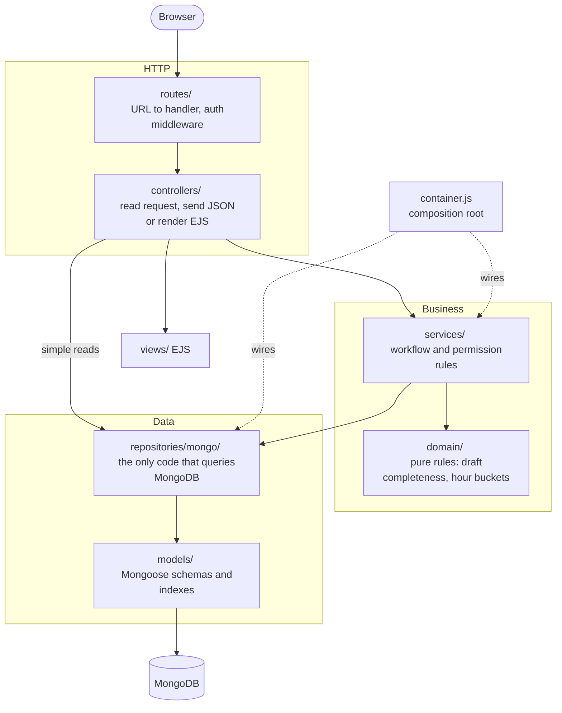

# The Daily Web

A news publication and newsroom workspace covering the full article lifecycle: drafting,
autosaving, editorial review, requested changes, approval, publication, post-publication
revisions, comments, view tracking and Impact Analytics.

**Technologies:** Node.js, Express, MongoDB with Mongoose, EJS server-side views, vanilla
JavaScript on the client, and the built-in `node:test` runner for automated tests.

**Main features:** a public news feed with infinite scroll, search, filters and sorting;
server-rendered article pages with guest comments; a reporter workspace with autosave; an
editorial review workflow (submit, approve, request changes, update a live article); a staff
directory; per-article Impact Analytics; and a cached external weather widget.

## Install and run

Requirements: **Node.js 18 or newer** (the app uses the built-in `fetch`) and **MongoDB**,
either locally or on Atlas.

The commands below are meant to be copied as-is. Do not add trailing comments on the same
line — zsh does not treat `#` as an inline comment and will expand `~`.

```bash
npm install
cp .env.example .env
npm test
npm run seed
npm start
npm run verify
```

1. `npm install` — installs dependencies. All dependencies are pure JavaScript, so there is
   no native compilation step and the same `node_modules` works on macOS, Linux and Windows.
2. `cp .env.example .env` — creates the environment file. Open `.env` and set
   `SESSION_SECRET`, and `WEATHER_API_KEY` if you want a live weather widget. The app also
   starts without the file, using defaults.
3. `npm test` — runs the unit tests. No database is needed (see [Testing](#testing)).
4. `npm run seed` — seeds 500 articles, 6 users, comments and view history.
5. `npm start` — starts the server. Use `npm run dev` for automatic reload.
6. `npm run verify` — optional. Re-checks the project against the course requirements.

The site runs at <http://localhost:3000>.

## Testing

The project has two complementary test suites.

| Command | What it tests | Needs MongoDB |
|---|---|---|
| `npm test` | Unit tests of the business rules (services and domain), in `tests/` | No |
| `npm run verify` | End-to-end checks of the running server over HTTP | Yes |

`npm test` uses Node's built-in test runner (`node --test`), so no test framework is
installed. The services are tested against in-memory repositories
(`tests/support/memoryRepositories.js`) instead of MongoDB, which keeps the tests fast and
shows that the storage can be replaced without touching the business logic. They cover:

- the article state machine — every allowed and forbidden transition, ownership (403),
  missing articles (404), locking while pending (409), editing a live article, and
  deleting an article together with its comments and view data;
- staff accounts — validation, duplicate usernames, the last-editor rule, self-deletion;
- comments — empty and over-long text, comments only on published articles, author name;
- analytics — hourly buckets and the article total staying in sync, duplicate hours (409),
  invalid input;
- pure helpers — draft completeness, input sanitising, view formatting.

Run a single file with `node --test tests/articleService.test.js`.

The unit tests also run automatically on every push and pull request on Node 18, 20 and 22
(GitHub Actions, `.github/workflows/test.yml`).

### Verifying the requirements

`npm run verify` runs `verify.js`, which starts a server of its own on port 3101 (so a
running development server on 3000 is not disturbed), works through the requirements over
HTTP, and shuts the server down again. Every line of output describes the requirement it
checks, with a check number in brackets, and the run ends with a pass/fail count:

```
PASS  [195] the editor queue API is bounded to one page of rows  :: 200 rows (cap 200) in 11ms
PASS  [206] articles unchanged by the verification run  :: 500 -> 500

103/103 checks passed, 0 failures
```

It covers the feed and paging, search, filtering and sorting, the article page HTML, the full
state machine including every forbidden transition, the CRUD matrix for all four models, the
permission rules, the comment limit, the weather cache, continuity across a server restart,
and the demo data of clauses 204-214. Run `npm run seed` first: the checks assume the seeded
demo state, and they finish by asserting the database is exactly as they found it, so the
harness can be run repeatedly before the defence.

Two things are deliberately left to the live demonstration because they need a browser:
infinite scroll firing on scroll, and a new comment appearing without the list reloading.
Adding a headless browser would mean a dependency the course did not cover.

### Dependencies

| Package | Why it is used |
|---|---|
| `express` | Web server and routing |
| `mongoose` | MongoDB models, validation and queries |
| `ejs` | Server-rendered views |
| `express-session` | Session-based sign-in |
| `connect-mongo` | Stores sessions in MongoDB, so a signed-in user survives a server restart |
| `bcryptjs` | One-way password hashing (pure JavaScript, no native build step) |
| `express-rate-limit` | Server-side limit of 3 comments per minute and sign-in attempt limit |
| `dotenv` | Loads settings from `.env`, so no secret is written in the code |

### Environment variables

| Variable | Required | Description |
|---|---|---|
| `MONGO_URI` | no | Defaults to `mongodb://127.0.0.1:27017/daily_web` |
| `SESSION_SECRET` | in production | Key used to sign the session cookie. The server refuses to start in production without it |
| `PORT` | no | Defaults to 3000 |
| `NODE_ENV` | no | `development` or `production` |
| `TRUST_PROXY` | no | `true` only behind a reverse proxy; otherwise clients could fake their IP to dodge the comment limit |
| `WEATHER_API_KEY` | no | Free key from OpenWeatherMap. Without it the widget shows "Weather data is unavailable right now" |
| `WEATHER_CITY` | no | Defaults to `Tel Aviv` |

`.env` is never committed. `.env.example` is the only template kept in the repository.

### Demo users

The password for every seeded user is `123456`. These accounts are created by
`npm run seed` only, for demonstration purposes.

| Username | Role | Name |
|---|---|---|
| `reporter1` | Reporter | Elena Vasquez |
| `reporter2` | Reporter | Marcus Bell |
| `reporter3` | Reporter | Priya Raman |
| `reporter4` | Reporter | Jonah Keller |
| `editor1` | Editor | Sarah Chen |
| `editor2` | Editor | Daniel Okafor |

## Architecture

The code is split into layers. Each layer has one job and talks only to the layer below it.



A request flows like this: `routes/articles.js` checks the role → `articleController.changeStatus`
reads the body → `articleService.changeStatus` checks ownership and the allowed transition →
`articleRepository.update` writes to MongoDB → the controller logs and sends the JSON.

### Architecture decisions

- **Repository layer — the database is replaceable.** Only `repositories/mongo/*` imports the
  Mongoose models. They accept storage-neutral filters (`{ search, category, excludeIds }`)
  and return plain objects, so no other layer knows the query language. Moving to another
  database means writing new repositories with the same methods and changing the four
  `require` lines in `container.js`; services and controllers stay unchanged. The in-memory
  repositories used by the tests are a working second implementation.
- **Services hold the business rules (single responsibility).** The article state machine,
  the last-editor rule, comment validation and view counting live in `services/`. Controllers
  only translate between HTTP and the services.
- **Dependency injection (dependency inversion).** Each service is a factory —
  `createArticleService({ articleRepository, ... })` — that receives its repositories instead
  of importing them. `container.js` is the single place where the real implementations are
  chosen, which is also what lets the tests pass in fakes.
- **Errors as types, mapped in one place.** Services throw `AppError(status, message)`;
  repositories turn MongoDB's duplicate-key code into `DuplicateKeyError`. The central
  `middleware/errorHandler.js` turns any error into a JSON or HTML response, so error
  formatting is not repeated in every controller.
- **Open for extension.** A new workflow rule is a change in one service; a new storage, a
  new set of repositories. The routes, views and other services do not change.
- **Simple reads skip the service layer.** Page and feed reads with no rules (for example
  "the newest 20 published articles") call a repository directly from the controller. A
  pass-through service method would add code without adding a rule. Anything that decides
  something goes through a service.
- **Pure rules in `domain/`.** Logic that needs neither a framework nor a database (is the
  draft complete, which hour bucket a time falls into) is plain functions, used by services
  and tested directly.

## Project structure

```
server.js                 Entry point: middleware, session, route mounting
container.js              Composition root: picks the repositories and builds the services
seed.js                   Demo data seeding
verify.js                 Requirement checks, clause by clause (npm run verify)
config/
  constants.js            Categories, article states, roles, feed and queue page sizes
  db.js                   MongoDB connection
domain/                   Pure business rules (no framework, no database)
  article.js              Input sanitising, draft completeness, ownership
  analytics.js            Hour buckets and manual bucket parsing
services/                 Business logic, receives repositories by injection
  articleService.js       Drafts, autosave, editorial state machine, deletion
  userService.js          Staff accounts and the last-editor rule
  commentService.js       Comment rules and moderation
  analyticsService.js     View recording, chart data, manual view data
repositories/mongo/       Data access - the only code that uses the Mongoose models
  articleRepository.js    Feed, search, queue and article writes
  userRepository.js       Accounts; returns users without the password hash
  commentRepository.js    Comments
  analyticsRepository.js  Hourly view buckets
  queryHelpers.js         Regex escaping, duplicate-key translation
models/                   Mongoose schemas and indexes
  User.js                 Users, one-way password hashing
  Article.js              Articles, draft and published versions, indexes
  Comment.js              Comments
  Analytics.js            Hourly view buckets
controllers/              HTTP layer: request in, service call, response out
  authController.js       Sign in, sign out, current identity
  userController.js       Staff accounts (editors only)
  articleController.js    Feed, drafts, state transitions, deletion
  commentController.js    Comments and editor moderation
  analyticsController.js  Chart data, manual view data, resetting view data
  weatherController.js    External service with caching
  pageController.js       EJS page rendering
routes/                   REST routes and view routes
middleware/
  auth.js                 Server-side authentication and authorisation
  rateLimit.js            Comment and sign-in rate limits
  errorHandler.js         404 and centralised error handling
utils/
  logger.js               Writes logs to file and console
  asyncHandler.js         Forwards async errors to the error handler
  viewMappers.js          Maps DB documents onto view fields
  errors.js               AppError and DuplicateKeyError
tests/                    Unit tests (npm test)
  support/                In-memory repositories used by the tests
views/                    View layer (EJS)
  error.ejs               Generic error page
  pages/public/           Home, article page, search results, category page
  pages/reporter/         Reporter workspace
  pages/editor/           Review queue, version comparison, analytics, staff directory
  pages/auth/             Staff login
  partials/               Shared components
public/
  css/                    Design system (variables, base, utilities, components, layouts, pages)
  js/                     Client-side JavaScript (vanilla, no framework)
logs/app.log              Error and operational event log (created at runtime)
```

## Core functionality

### Home page
A feed of published articles only, with infinite scroll loading 20 articles at a time
(`IntersectionObserver` in `public/js/feed.js`), title search, category filtering,
read/unread filtering and sorting by publication date or popularity. All of these run over
Ajax with no full page reload. The `/search` page works the same way: its search box,
category and sort filters update the results, the result count and the per-category counts
in place (`public/js/searchPage.js`), and the address bar follows so a refresh keeps them.

### Article page
Fully server-rendered: the headline, body and comments are present in the initial HTML, so
the page is accessible to search engines without JavaScript. Posting a comment happens over
Ajax and the new comment appears immediately without reloading the list.

### Article states and transitions

| State | Moved by | To |
|---|---|---|
| Draft (`draft`) | Reporter | Pending Review |
| Pending Review (`pending`) | Editor | Published / Changes Requested |
| Changes Requested (`returned`) | Reporter | Pending Review |
| Published (`published`) | Reporter (editing) | back to Draft |

Every other transition is rejected on the server. Moving to `pending` is blocked when the
title, summary, content or category is missing.

### Editing a published article
The model separates `status` (the editorial state of the draft) from `isPublished` (whether a
public version exists). `publishedVersion` is what readers see and `draftVersion` is what the
reporter is working on. A published article therefore stays visible to the public while an
update to it is awaiting approval, and the new content replaces it only once an editor
approves.

### Work continuity
Drafts persist two ways, and both write to MongoDB:

- **Background autosave** — `public/js/article-editor.js` saves five seconds after the
  reporter stops typing, and immediately if the tab is hidden or closed. It only sends a
  request when the content actually changed, so idle pauses do not generate traffic. This
  satisfies the requirement that work is kept without a deliberate click on a Save button,
  and that refreshing, closing the browser or moving to another computer loses nothing.
- **Save Draft** — an explicit action for reporters who want to confirm the save themselves.

Because drafts live in MongoDB rather than the browser, returning to the editor always
restores the last version the reporter worked on, from any machine.

### Editor workspace
All articles with filtering by state, category and search. The review page shows the
published version and the version awaiting approval side by side, so it is clear what is
currently public and what would replace it. The editor can approve and publish, request
changes with a note (a note is required), and delete an article along with its comments and
view data.

The pending pane on the review page is **editable**, so an editor can correct the copy
himself while comparing it against what readers currently see. Saving there reuses
`PUT /api/articles/:id`, which leaves a `pending` article pending, so the approve and
return actions stay valid immediately afterwards. When an editor edits an article that is
already published, the edit goes straight to `pending` (a reporter's edit goes to `draft`),
so the editor can approve their own correction. The return note is required on the server
as well, not only in the form.

The queue is paged: a request returns at most `QUEUE_PAGE_SIZE` (200) rows, and the
"Showing N of M" line reports the true number of articles the current filters match, counted
by `Article.countDocuments()` rather than inferred from the rows on screen. When the matches
exceed one page the response sets `hasMore` and the page says so, so the queue stays fast with
thousands of articles instead of rendering every row.

The "Preview as it will appear" link on the review page opens `/editor/reviews/:id/preview`,
an editor-only page that renders the saved pending version (`draftVersion`) with the public
article template. It records no view and shows no comments, and works for articles that have
never been published. The public `/articles/:id` page keeps showing the approved version.

Editors also moderate comments in place on the public article page — editing the text or
deleting the comment — and can reset an article's recorded view data from the analytics page.

### Staff directory
`/editor/staff` is an editor-only area for managing reporter and editor accounts: create,
search by username or display name, rename, change role, replace the password, and delete.
Updates go through `doc.save()` so the `pre('save')` hashing hook always runs and a password
is never stored in plain text. An editor cannot delete their own account, and the last
remaining editor can be neither deleted nor demoted, so the system always has an
administrator.

### Impact Analytics
`public/js/analyticsChart.js` draws on a plain `<canvas>` with no external library: a time
axis covering the whole selected range, view counts along it (hours with no views are drawn as
zero), and dashed vertical lines at every point where an editor approved and published an
update. Markers are numbered by their position in the article's full approval history, so
"Update 3" stays "Update 3" whichever range is selected. Under the chart, one line per update
gives the average views per hour in the 24 hours before and after it, and hovering the line
shows the exact views for that hour. The page opens on a three-week range so the original
publication and the seeded update markers are all visible.

Views are pre-aggregated into hourly buckets (`models/Analytics.js`) rather than one row per
view. Each view is a single atomic `$inc` with `upsert`, so thousands of concurrent readers
neither lose counts nor create write pressure. If two readers create the same hour bucket at
the same moment, the unique index rejects the second upsert and the view is retried once. Counting a view does not touch `updatedAt`, so
reader traffic never reorders the review queue or changes the reporter's "last updated" time. `Article.totalViews` is maintained alongside so
that sorting by popularity is a single query with no aggregation.

### External service — weather
`controllers/weatherController.js` calls OpenWeatherMap on the free tier (no payment details)
and caches the result for 15 minutes. An `inFlight` guard prevents parallel calls when the
cache expires, so thousands of visitors translate into one external call per 15 minutes. On
failure it never serves a value older than 15 minutes: the widget shows "Weather data is
unavailable right now" instead; the external service is then not retried for a minute, so an outage does not turn
every page view into another failing call.

## Security and permissions

- Three user types: Guest, Reporter, Editor.
- Passwords are stored only as one-way bcrypt hashes and cannot be recovered.
- Permissions are derived from the server-side session, never from data sent by the browser.
- Every protected route is checked on the server (`middleware/auth.js`). Hiding a button in
  the client is not authorisation.
- The role is re-read from the database on every staff request, so demoting or deleting an
  account takes effect immediately, even for a session that is already signed in.
- Comments are listed only for published articles.
- A reporter can edit only their own articles and cannot publish. An editor can view, edit,
  approve, return and delete.
- Sessions are stored in MongoDB (`connect-mongo`), so a signed-in user stays signed in
  across a server restart.
- All user text is output through `<%= %>` in EJS or `escapeHtml` on the client, preventing
  HTML injection.
- Rate limits: up to 3 comments per minute per device, identified by its IP address (the
  server cannot see a device any other way), and up to 20 sign-in attempts per 5 minutes.
- The session id is regenerated on sign-in, so an id held before signing in is never reused.
- User input is truncated to allowed lengths and categories are validated against a fixed list.
- Errors are handled on both sides. The client marks the four required fields on the reporter
  form and names the missing one before submitting for review; the server rejects the same
  submission independently in `isDraftComplete()` in `domain/article.js`. Autosave deliberately skips that
  check so a partial draft is still saved and no work is lost.

## REST endpoints

| Method | Path | Access | Description |
|---|---|---|---|
| POST | `/api/auth/login` | public | Sign in |
| POST | `/api/auth/logout` | public | Sign out |
| GET | `/api/auth/me` | public | Current user |
| GET | `/api/users` | Editor | Staff directory, `?search=` on username/display name |
| POST | `/api/users` | Editor | Create a staff account |
| PUT | `/api/users/:id` | Editor | Update name, role, password |
| DELETE | `/api/users/:id` | Editor | Delete a staff account |
| GET | `/api/articles/feed` | public | Feed with paging, search, filter and sort |
| GET | `/api/articles/mine` | Reporter | Own articles |
| GET | `/api/articles/manage` | Editor | All articles with filtering by status, category, and search |
| GET | `/api/articles/:id` | Reporter/Editor | Single article |
| POST | `/api/articles` | Reporter | Create article |
| PUT | `/api/articles/:id` | Reporter/Editor | Save draft |
| PATCH | `/api/articles/:id/status` | Reporter/Editor | State transition |
| DELETE | `/api/articles/:id` | Editor | Delete article |
| GET | `/api/comments/article/:id` | public | Comments for an article (`?search=` filters by text) |
| POST | `/api/comments/article/:id` | public | Add comment (rate limited) |
| PUT | `/api/comments/:id` | Editor | Edit comment text |
| DELETE | `/api/comments/:id` | Editor | Delete comment |
| GET | `/api/analytics/articles` | Editor | Articles selectable in the chart |
| GET | `/api/analytics/article/:id` | Editor | Timeline, views and publish events |
| POST | `/api/analytics/article/:id` | Editor | Record one hour's view count (`{ timestamp, viewsCount }`) |
| PUT | `/api/analytics/article/:id` | Editor | Correct an existing hour's view count |
| DELETE | `/api/analytics/article/:id` | Editor | Reset an article's view data |
| GET | `/api/weather` | public | Cached weather |

### CRUD coverage per model

Every model supports the full set of operations through the REST API.

| Model | Create | Read (list / search) | Update | Delete |
|---|---|---|---|---|
| `User` | `POST /api/users` | `GET /api/users`, `GET /api/users?search=` | `PUT /api/users/:id` | `DELETE /api/users/:id` |
| `Article` | `POST /api/articles` | `GET /api/articles/feed?search=&category=`, `/mine`, `/manage?status=`, `GET /api/articles/:id` | `PUT /api/articles/:id`, `PATCH /api/articles/:id/status` | `DELETE /api/articles/:id` |
| `Comment` | `POST /api/comments/article/:id` | `GET /api/comments/article/:id`, `GET /api/comments/article/:id?search=` | `PUT /api/comments/:id` | `DELETE /api/comments/:id` |
| `Analytics` | `POST /api/analytics/article/:id`, and one atomic `upsert` + `$inc` per article view (`pageController.articlePage`) | `GET /api/analytics/articles`, `GET /api/analytics/article/:id` | `PUT /api/analytics/article/:id`, and the same `$inc` per view | `DELETE /api/analytics/article/:id`, and cascaded on article deletion |

Reader traffic never goes through the POST/PUT endpoints: a view is one atomic `updateOne`
with `upsert`, which creates the hourly bucket the first time and increments it afterwards.
That is what keeps the counter correct under concurrent readers. The editor-only POST/PUT
endpoints record or correct one hour's count manually and move the article's `totalViews`
by the same amount, so popularity sorting stays consistent with the chart.

### View routes

`/` home · `/category/:category` category · `/search` search · `/articles/:id` article page ·
`/staff/login` sign in · `/reporter/articles` my articles · `/reporter/articles/new/edit` new article ·
`/reporter/articles/:id/edit` edit · `/editor/reviews` review queue ·
`/editor/reviews/:id` version comparison · `/editor/reviews/:id/preview` editor-only preview of
the pending version as readers will see it · `/editor/staff` staff directory ·
`/editor/analytics` and `/editor/articles/:id/analytics` analytics

## Models and indexes

| Model | Indexes |
|---|---|
| `User` | `username` unique |
| `Article` | `(isPublished, publishedAt)`, `(isPublished, totalViews)`, `(isPublished, category, publishedAt)`, `(reporter, updatedAt)`, `(status, updatedAt)` |
| `Comment` | `article`, `(article, createdAt)` |
| `Analytics` | `(article, timestamp)` unique |

Paging, filtering and sorting all happen in the database, and the feed selects only the
fields the card displays rather than the full article body, so the system stays fast with
thousands of articles.

## What to demonstrate

1. **Permissions** — try `/editor/reviews` as a guest and as a reporter, and try editing
   another reporter's article.
2. **Work continuity** — type in the article editor without clicking Save, then refresh the
   page, close the browser, or open the same article in another browser: the latest text is
   there.
3. **Server restart** — stop and restart the server while signed in.
4. **Versions** — edit a published article, submit it for approval, and confirm the public
   still sees the previous version.
5. **Search and paging** — infinite scroll and filtering over 500 articles.
6. **Comment limit** — post four comments in a minute and get blocked by the server.
7. **Weather** — first request hits the service, the second is served from cache.
8. **Impact Analytics** — pick an article with several updates and identify the view spike
   around each update point.
9. **Staff management** — as `editor1`, open `/editor/staff`, create a reporter, search for
   them, rename them, sign in as them to prove the password was hashed, then delete them. Try
   deleting your own account and demoting the last editor; both are refused by the server.
10. **Editor edits a story** — open a pending article in the review queue, change the headline
    in the pending pane, reload to confirm it persisted, then approve and see it go public.
